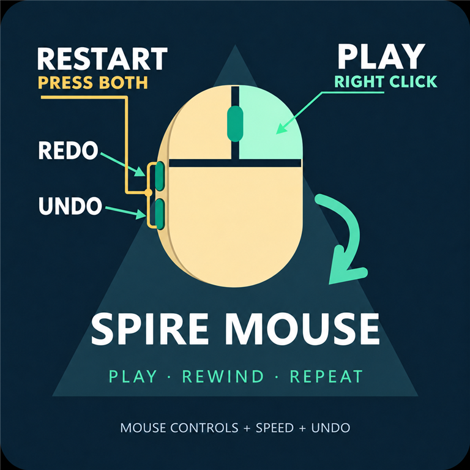

# Spire Mouse

[English](README.md) · [Steam 창작마당](https://steamcommunity.com/sharedfiles/filedetails/?id=3808397695&l=koreana)

**우클릭으로 카드를 사용하고, 사이드 버튼으로 되돌리세요.**

Slay the Spire 2의 마우스 조작, 배속, 전투 Undo/Redo, 층 재시작을 하나로 모은 편의 모드입니다. 필수 선행 모드 없이 단독으로 사용할 수 있습니다. 현재 공개 버전은 **2.0.0-beta.19**입니다.



## 설치와 조작

창작마당에서 구독한 뒤 게임의 모드 메뉴에서 활성화하세요.

| 기본 입력 | 동작 |
|---|---|
| 카드 우클릭 | 카드 사용 또는 대상 지정 시작 |
| 대상 우클릭 / 우클릭 드래그 후 놓기 | 원하는 대상에게 카드 사용 |
| 카드 선택창에서 우클릭 | 선택·해제 |
| 유효한 선택 후 빈 곳 우클릭 | 선택 확정 |
| 전투의 빈 곳 더블 우클릭 | 턴 종료 |
| 보상·선택을 마친 뒤 빈 곳 우클릭 | 다음으로 진행 |
| 뒤쪽 사이드 버튼(M4) | Undo |
| 앞쪽 사이드 버튼(M5) | Redo |
| 두 사이드 버튼 함께 누르기 / F5 | 층 재시작 |
| Esc | 대상 지정 취소 |

게임 설정 → Spire Mouse에서 단축키, 배속, 기록 수, 카드 선택 기록, 행동 기록 패널을 조정할 수 있습니다. 미수령 보상이나 필수 선택을 자동으로 넘기지는 않습니다.

## 전투 재시작도 되돌리기

`전투 진행 → 재시작 → Undo하면 직전 상태 → Redo하면 재시작 직후`

재시작 이전의 행동과 진행 중이던 카드 선택도 복원합니다. Undo한 뒤 새 행동을 하면 기존 Redo 경로는 사라집니다. 재시작 경계를 넘는 복원에는 일반 Undo보다 시간이 걸릴 수 있습니다.

Undo/Redo와 재시작은 싱글플레이 전용입니다. 이벤트 선택과 전투 종료 뒤 이전 전투로 돌아가는 Undo는 지원하지 않습니다. 비전투 방 재시작은 가능하지만 그 재시작을 Undo/Redo할 수는 없습니다. 기록은 현재 방의 메모리에 보관되며 게임 종료 후에는 유지되지 않습니다.

## 소스 빌드

Windows, .NET SDK 9와 별도로 설치한 게임이 필요합니다. Godot.NET.Sdk 4.5.1은 프로젝트 복원 시 가져옵니다. 게임 DLL은 이 저장소에 포함되지 않습니다.

```powershell
$env:STS2_INSTALL_DIR = 'D:\SteamLibrary\steamapps\common\Slay the Spire 2'
.\build.ps1
```

결과는 `dist/SpireMouse/`에 생성됩니다. 배포 DLL에는 개발자용 테스트가 포함되지 않습니다. 자세한 빌드 옵션은 [영문 README](README.md#build-from-source)를 참고하세요.

beta.19의 실게임 검증 환경은 Windows / 게임 v0.113.1 public-beta였습니다. [검증 기록과 범위](docs/VERIFICATION.md)를 확인할 수 있습니다. 게임의 비공개 API를 사용하므로 게임 업데이트나 다른 모드의 상태에 따라 호환성 작업이 필요할 수 있습니다.

버그는 [Issues](https://github.com/rpr123/SpireMouse/issues)에 게임·모드 버전, 재현 순서, 관련 모드와 로그를 함께 남겨 주세요.

## 라이선스

[MIT](LICENSE). 배속 구성 요소는 [OLC / STS2-QuickAnimationMode](https://github.com/BAKAOLC/STS2-QuickAnimationMode)에서 가져와 수정했으며 [원본 MIT 라이선스](LICENSE-SpeedControl.txt)를 유지합니다. 자세한 출처는 [PROVENANCE.md](docs/PROVENANCE.md)에 기록했습니다.
