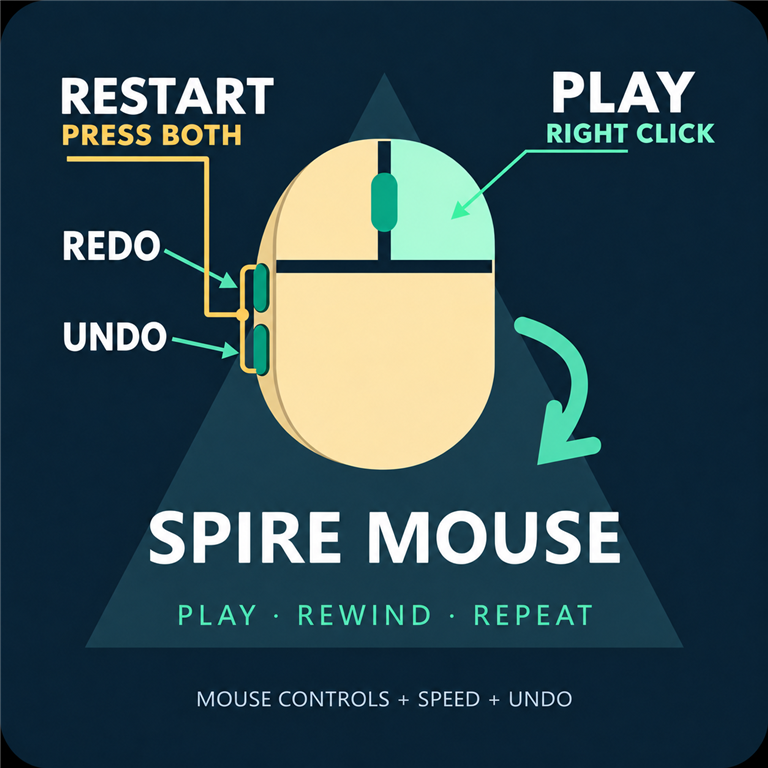

# Spire Mouse

[한국어](README.ko.md) · [Steam Workshop](https://steamcommunity.com/sharedfiles/filedetails/?id=3808397695)

**Right-click to play. Use your side buttons to undo.**

Mouse controls, adjustable speed, combat Undo/Redo, and room restarts for **Slay the Spire 2**. No prerequisite mods are required.



## Install

Subscribe on the [Steam Workshop](https://steamcommunity.com/sharedfiles/filedetails/?id=3808397695), then enable Spire Mouse in the game's mod menu. The current published version is **2.0.0-beta.19**.

## Default controls

| Input | Action |
|---|---|
| Right-click a card | Play it, or begin targeting if a target is required |
| Right-click the target | Play the selected card on that target |
| Hold right-click, drag to a target, release | Play a targeted card |
| Right-click a card in a selector | Select or deselect |
| Right-click empty space in a selector | Confirm a valid selection |
| Double right-click empty space in combat | End the turn |
| Right-click empty space after rewards/choices are complete | Continue |
| Rear thumb button (M4) | Undo |
| Front thumb button (M5) | Redo |
| Both thumb buttons together, or F5 | Restart the room |
| Esc | Cancel targeting |

Change bindings, speed, history capacity, card-selection checkpoints, and the history panel in **Settings → Spire Mouse**. Required choices and unclaimed rewards are not automatically skipped.

## Undo a combat restart

`Play → Restart → Undo returns to before restart → Redo returns to the restarted opening.`

Earlier actions and a pending card selection can be restored. New input after Undo replaces the redo branch. Crossing a restart can take longer than an ordinary Undo.

- Undo/Redo and restarts are singleplayer features.
- Undo/Redo is available during combat. Event choices and returning to a finished combat from rewards are not supported.
- Non-combat room restarts remain available, but cannot be undone or redone.
- History is held in memory for the current room and does not survive quitting.

## Build from source

The current source targets **Windows**, **.NET SDK 9**, and **Godot.NET.Sdk 4.5.1**. The latter is restored by the project. The game must be installed separately; game assemblies are not distributed here. The beta.19 runtime checks used game **v0.113.1 public-beta**.

From PowerShell in this repository:

```powershell
$env:STS2_INSTALL_DIR = 'D:\SteamLibrary\steamapps\common\Slay the Spire 2'
.\build.ps1
```

Or pass the installation directory directly:

```powershell
.\build.ps1 -GameDirectory 'D:\SteamLibrary\steamapps\common\Slay the Spire 2'
```

Production files are written to `dist/SpireMouse/`. `Verify=false` is used, so active developer verification is excluded from the production DLL. For a manual installation, copy that folder to the game's `mods` directory. Use one selected installation of Spire Mouse rather than leaving several manual copies.

Direct MSBuild invocation is also supported:

```powershell
dotnet build SpireMouse.csproj -c Release -p:Verify=false '-p:Sts2InstallDir=D:\SteamLibrary\steamapps\common\Slay the Spire 2'
```

## Developer verification

Tests are opt-in actual-game scenarios compiled only with `Verify=true`. They use the game's memory-only test save store. See [verification notes](docs/VERIFICATION.md) for the previously completed checks, scope, and invocation. Building the project does not launch the game or publish anything.

The implementation uses private game APIs. Game updates and third-party state outside the captured models may require compatibility work. See [restart history](docs/RESTART-HISTORY.md) and [restoration architecture](docs/RESTORE-ARCHITECTURE.md).

## Report a problem

Open a [GitHub issue](https://github.com/rpr123/SpireMouse/issues) with the game/mod versions, relevant enabled mods, steps to reproduce, and what happened. Include the relevant log excerpt when available.

## License and credits

MIT; see [LICENSE](LICENSE). The speed component is adapted from [OLC's STS2-QuickAnimationMode](https://github.com/BAKAOLC/STS2-QuickAnimationMode), retaining its [MIT license](LICENSE-SpeedControl.txt). Source provenance and the excluded earlier integration are described in [PROVENANCE.md](docs/PROVENANCE.md).

Game assemblies, decompiled game code, SDK binaries, saves, and developer artifacts are not part of this repository.
